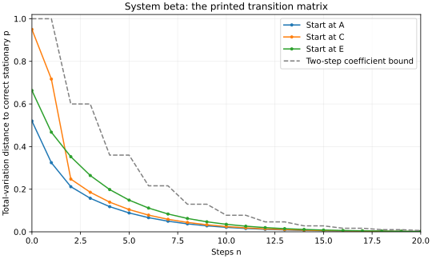

# Numerical erratum: Observer Convergence, System beta

This note supplies reproducible corrections to §4.3 (PDF pp.7–8) of
[Observer Convergence s8 Fix.pdf](../Observer%20Convergence%20s8%20Fix.pdf),
as published at revision `8b33d720168967513920812cd565be4c61a5117b`.
It preserves the printed transition matrix. This contribution was prepared
with AI assistance; all stated numerical checks were executed.

## Corrected values for the printed matrix

With column probability vectors, `p_next = Kp`, the matrix is:

```text
K = [[.80, .85, .05, .05, .05],
     [.05, .05, .80, .05, .05],
     [.05, .05, .05, .05, .05],
     [.05, .00, .05, .05, .05],
     [.05, .05, .05, .80, .80]]
```

| Quantity | Printed | Corrected |
|---|---|---|
| Stationary distribution | (.38, .12, .05, .05, .40) | (.48, .0875, .05, .045625, .336875) |
| Dobrushin coefficient of K | approximately .75 | .8 |
| Dobrushin coefficient of K squared | approximately .56 | .6 |
| Two-step coefficient-only bound at n=20 | below .003 | .0060466176 |

Multiplying the printed stationary vector by K produces residual
`(.051, -.0325, 0, -.006, -.0125)`. Its total-variation distance from the
correct vector is .1, so this discrepancy is not rounding error.

The coefficient-only bound is `.6^floor(n/2)`. The usual sharper form also
multiplies by the initial distance to equilibrium. The *actual* maximum
distance after20 steps, over all initial probability distributions, is
approximately `.001987292815`, below .003. The maximum is obtained by
checking the five point-mass starts: convexity of total variation bounds
any mixture by the largest of their distances. Thus the qualitative
20-step observation survives, although the printed calculation does not.

## Replacement for Figure 4



The three solid curves use the same initial states described by Figure4.
The dashed line is a coefficient-only bound, not an observed trajectory.
All distances use the corrected equilibrium. The underlying PDF has not
been regenerated because its editable source is not included in this
repository.

## Reproduction

The checks require Python3 and its standard library only:

```sh
python3 errata/observer_convergence_checks.py
```

The script solves stationarity by exact rational Gaussian elimination,
checks the residual and both coefficients, and calculates the worst-case
20-step distance using exact fractions. It also checks the two
changing-kernel examples below.

To regenerate the plot, install matplotlib in your preferred Python
environment, then run:

```sh
python3 errata/observer_convergence_checks.py --plot errata/observer_convergence_beta.svg
```

## Convention and modeling decisions

The paper defines columns as transition probabilities from a state.
Consistent notation is `Kp*=p*` and `p_n=K_n ... K_1 p_0`. Alternatively,
transpose the matrix and use row vectors consistently.

The zero entry in K does not prevent primitivity or a positive multi-step
noise floor. It does mean K has no positive entrywise one-step floor. If
the intended example was a different uniform-noise construction, its
matrix and numerical results should instead be changed together.

The corrected stationary distribution places .183125 of its mass outside
the deterministic fixed states A/E. A full-support primitive equilibrium
should be distinguished from a deterministic limit supported on fixed
states; this note does not replace the paper's intended theorem.

## Two checks relevant to the changing-kernel statement

Condition3.2(c) bounds individual powers. Such a bound alone does not
control products of different successive matrices. The script verifies
primitive A and B with `min(A^5)=min(B^5)=1/8`, but BA has two disjoint
invariant distributions. These A/B do not have a common primitive support
subgraph, so they do not refute a suitably strengthened common-support
hypothesis. They isolate the difference between the displayed condition
and the stronger prose.

Separately, two alternating positive rank-one matrices forget all initial
conditions after one step while their output alternates forever. This
illustrates Remark6.12's distinction between weak ergodicity and a
stationary limit. Both examples are supplied for review of the assumptions,
not as substitutes for the physical model.
